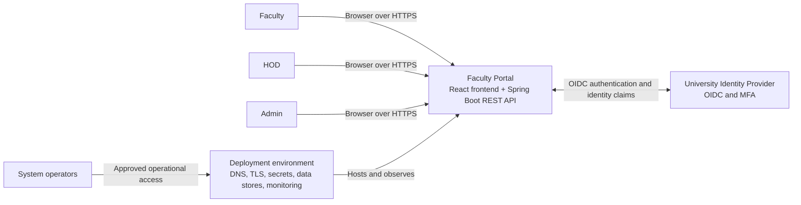
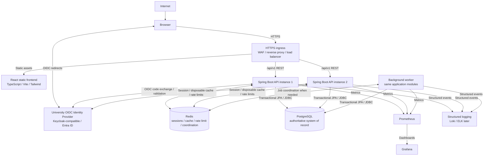
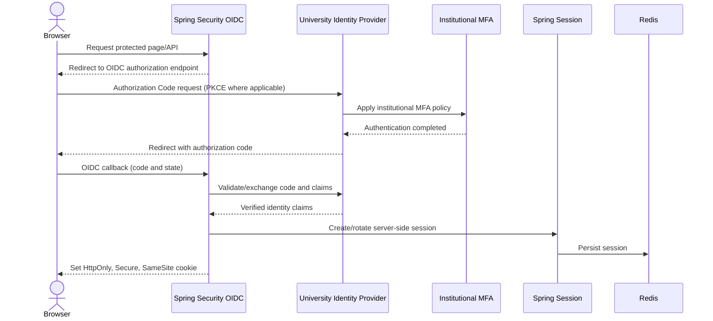
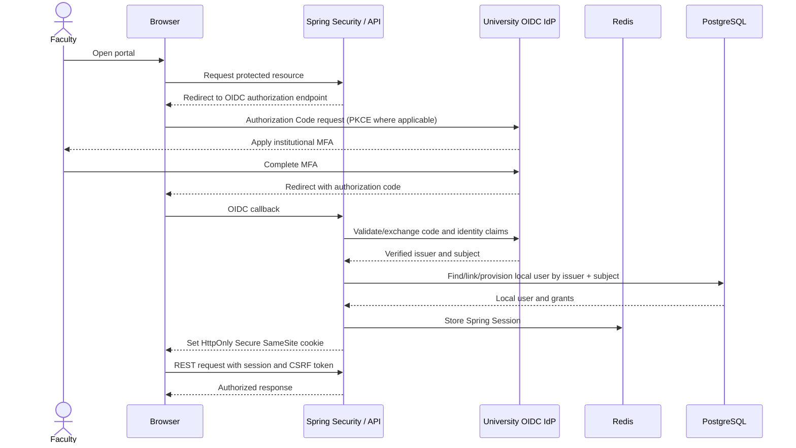
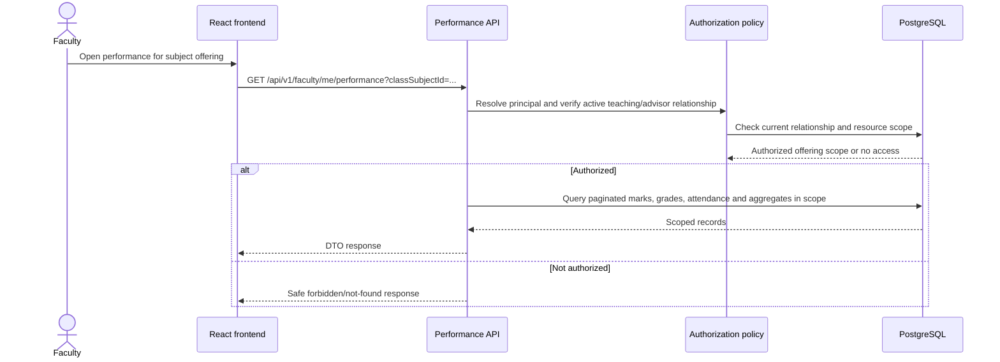
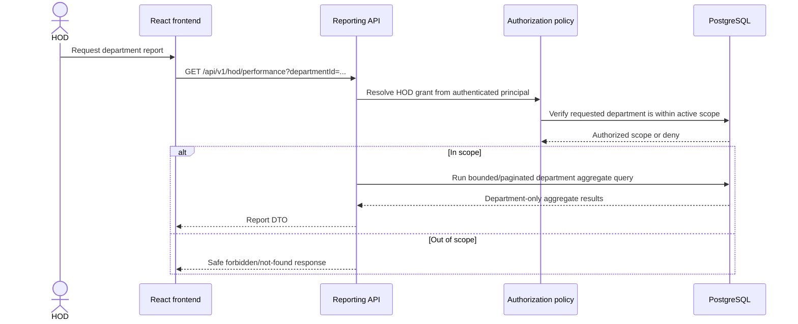

# University Faculty Portal Architecture

**Status:** Authoritative target architecture, pending stakeholder approval  
**Scope:** Architecture and implementation boundaries; this document does not implement the application.  
**Companion specifications:** See the database, API, security, authorization, exam-duty allocation, and deployment documents named in the final architecture rule.

## Scope and Technology Decisions

The initial system is a modular monolith: one Spring Boot application organized into explicit business modules, with API and background-worker processes deployable separately from the same application artifact and domain modules. It uses one PostgreSQL system of record. Modules are not microservices. Split a module into a separately operated service only when measured scaling, availability, or team/deployment constraints demonstrate a meaningful operational reason.

| Concern | Decision |
|---|---|
| Backend | Java 21, Spring Boot, Spring Security, Spring Data JPA |
| Frontend | React, TypeScript, Vite, Tailwind CSS |
| Primary persistence | PostgreSQL; all schema evolution is managed by Flyway |
| Identity | OIDC and OAuth 2.0 Authorization Code flow through a Keycloak-compatible university identity provider; support Microsoft Entra ID/Active Directory or another institutional provider through configuration and claim mapping |
| Browser authentication | Spring Security OIDC and server-side Spring Session stored in Redis; opaque secure cookie and CSRF protection; no tokens in browser localStorage |
| Cache/session/limits | Redis for sessions, disposable short-lived caches, rate limiting, and appropriate worker coordination; never authoritative academic or assignment data |
| API | Versioned REST under `/api/v1/`; OpenAPI is the contract |
| Jobs | Background worker process from the same Spring Boot application/domain modules; PostgreSQL-backed idempotency/job tracking |
| Local development | Docker Compose; synthetic data and non-production identity provider only |
| Operations | HTTPS load balancer/reverse proxy, multiple API instances, Prometheus metrics, Grafana dashboards, structured logs; Loki/ELK may be introduced later |
| Testing | Unit, integration, security, authorization, concurrency and API tests; JUnit, Mockito, Testcontainers; frontend tests; k6 or Apache JMeter load tests |

## 1. Architecture Principles

These are non-negotiable constraints for implementation:

1. PostgreSQL is the source of truth for application, academic, policy, job, and exam-duty data.
2. Redis is never authoritative for academic data, workload obligations, exam duties, duty capacity, or duty assignments. Cached values can be discarded and reconstructed from PostgreSQL.
3. Backend authorization is mandatory for every protected operation. Frontend route guards and hidden controls improve usability only and are never security controls.
4. Business rules and authoritative validation live in the backend. The frontend may validate early for user experience, but the backend repeats all validation.
5. JPA entities and persistence models are never exposed directly through REST. Use validated request DTOs and explicit response DTOs.
6. Every database schema change is a reviewed Flyway migration. No runtime schema mutation or ad hoc production DDL.
7. Secrets are never committed to source code, images, or logs. Supply secrets through environment-specific secret management.
8. Application instances are stateless. Any required session state is externalized; no correctness requirement depends on process-local memory.
9. Critical business operations use PostgreSQL transactions and appropriate locking/constraints, especially duty selection and assignment.
10. Do not introduce microservices, brokers, or other infrastructure without a demonstrated operational/scaling reason. Prefer simple, maintainable architecture.
11. Use least privilege, explicit module boundaries, observability, and automated verification from the start.

## 2. System Context

### Actors

| Actor | Interactions |
|---|---|
| FACULTY | Signs in through university SSO; views own dashboard, eligible exam duties, teaching subjects, authorized student performance, advisor-class information when appointed, notifications, and reports; selects duties. |
| HOD | Signs in through university SSO; views faculty, duty completion, classes, and academic reports scoped to authorized department(s). No cross-department access is implied. |
| ADMIN | Signs in through university SSO; manages portal configuration, faculty/academic structures, workload policy, exams/duties, advisor appointments, assignments, audit records, and system-wide reports. |
| UNIVERSITY IDENTITY PROVIDER | Authenticates users, enforces institutional MFA and identity policy, and issues OIDC identity claims. The portal does not own university passwords. |
| SYSTEM OPERATORS / DEPLOYMENT ENVIRONMENT | Operate deployment, DNS, TLS/WAF/proxy, secrets, database/Redis availability and backups, monitoring, release pipeline, and incident response. Operators are not automatically application administrators. |

Faculty, HOD, and Admin use the browser frontend. The browser communicates with the Spring Boot API over HTTPS. The API communicates with PostgreSQL and Redis and redirects the browser to the external identity provider for sign-in. Operators interact through approved infrastructure and deployment controls, not direct public access to data stores.



## 3. High-Level System Architecture

The production topology supports multiple Spring Boot API instances behind a load balancer. PostgreSQL is the authoritative store and is accessed by API and worker processes. Redis supports sessions, rate limiting, short-lived caches, and coordination only; it does not replace PostgreSQL.



Production should serve frontend and API same-site where practical. The reverse proxy serves static files and routes `/api/` to the API pool. Browser code cannot connect directly to PostgreSQL or Redis. Identity is an external institutional service. Local Keycloak is for development and integration testing only.

## 4. Frontend Architecture

The frontend is a React application written in TypeScript, built with Vite and styled with Tailwind CSS. It owns presentation, client-side routing, form handling, API interaction, and client-side validation for usability. It provides explicit loading, error, empty, and success states and can hide actions that the current user cannot use.

The frontend MUST NOT be trusted for authorization and MUST NOT contain authoritative business rules. A user can alter browser state or call APIs directly; the backend revalidates identity, resource scope, dates, capacity, quota, and all business constraints on each request.

| Area | Main screens |
|---|---|
| Faculty | Dashboard; Exam Duties; Subjects; Student Performance; Classes; Class Advisor; Notifications; Reports; Settings |
| HOD | Dashboard; Department Faculty; Department Performance; Duty Monitoring; Classes; Reports |
| ADMIN | Dashboard; Faculty Management; Department Management; Subject/Class Management; Exam Management; Duty Management; Workload Configuration; Class Advisor Management; Audit Logs; Reports; System Settings |

Frontend areas are organized by user workflow and call versioned REST APIs using DTO contracts. Authorization-sensitive data is not filtered only in the browser. Routes, controls, and cached client state are refreshed when session/capabilities change; this improves UX but does not replace backend checks.

## 5. Backend Modular Monolith

One Spring Boot application contains the following modules. Each module has explicit ownership and interfaces; it initially runs in the same application and deployment artifact. Modules must not access another module's persistence internals directly; cross-module use goes through application/domain interfaces or well-defined transaction-level orchestration. Shared/platform code contains technical primitives, not a dumping ground for domain logic.

| Module | Responsibility and data owned | Major services / APIs | Dependencies |
|---|---|---|---|
| `identity` | Local user identity linked to OIDC issuer/subject, provisioning/linking, active status, login/logout integration. | OIDC/session integration; provisioning service; `/auth/*`, `/me`. | Spring Security; authorization for capability resolution; organization profile lookup. |
| `authorization` | Role grants, permission mapping, department scope, resource-level decisions. | Authorization policy services and request security; policy checks used by every protected API. | Identity, organization, teaching, exam, performance. Other modules call policies rather than duplicating scope logic. |
| `organization` | Departments, faculty, designations, students, academic years, classes, enrollments. | Organization application services; admin organization APIs; faculty/class lookup APIs. | Identity for local user association; authorization for scoped operations. |
| `teaching` | Subjects, class offerings, faculty teaching assignments, effective-dated class advisors. | Assignment/advisor services; faculty subject and advisor APIs. | Organization; authorization; performance for relationship-scoped access. |
| `exam` | Exams, duty openings, eligibility, selection windows/status, assignment records, monthly obligation snapshots, manual assignment/cancellation. | Duty lifecycle and shared transactional assignment service; faculty selection and admin duty APIs. | Identity, organization, workload policy, authorization, audit, notification. |
| `allocation` | Scheduled deadline processing, allocation job state, candidate ranking, retries, unfilled obligations. | Idempotent allocation coordinator/worker; admin allocation status/run APIs. | Exam assignment service, organization/teaching availability inputs, audit, notification, PostgreSQL job state. |
| `performance` | Assessments, marks, grade calculation, attendance, authorized aggregates and trends. | Academic query/report services; faculty, advisor, HOD and admin performance APIs. | Organization, teaching, authorization; PostgreSQL. |
| `notification` | In-app notification content and read state; future delivery abstraction. | Notification generation/inbox APIs; future email adapter. | Identity, exam, allocation, audit/outbox as required. |
| `audit` | Append-only administrative/security action history and access controls. | Audit writer/query service; scoped admin audit API. | Identity and calling modules; PostgreSQL. Audit writes participate in the business transaction where required. |
| `reporting` | Bounded reports, departmental/system aggregates, large report/export job orchestration. | Report query services and report job APIs. | Performance, exam, organization, authorization, background job platform. |
| `shared/platform` | DTO validation primitives, error mapping, clock, transaction conventions, request IDs, outbox/job infrastructure, health and observability integration. | Cross-cutting technical interfaces only. | Framework and infrastructure integrations; must not own faculty/exam/performance business rules. |

Module dependencies must remain acyclic where practical. If a workflow spans modules, an application service orchestrates module interfaces inside a transaction where consistency requires it. These boundaries are not a mandate to deploy modules independently.

## 6. Identity and SSO Architecture

Use OpenID Connect (OIDC) for authentication and OAuth 2.0 Authorization Code flow for the browser-based application. Use PKCE where supported/appropriate, along with state, nonce, redirect URI, issuer, audience, signature, and token-time validation. The configuration must be compatible with Keycloak and allow Microsoft Entra ID/Active Directory or another university identity provider through provider metadata, client configuration, and claim mapping. MFA is enforced by the identity provider, not implemented as a portal-owned second-factor system.

### Browser authentication model



The browser receives an opaque session cookie with `HttpOnly`, `Secure`, and an appropriate `SameSite` policy, scoped path/domain, expiration, and rotation on authentication/privilege change. State-changing requests use CSRF protection. Authentication/access/refresh tokens must not be stored in localStorage or exposed to application JavaScript. Redis loss must not cause fallback to insecure process-local sessions.

Map external identities using `(issuer, subject)`, which is the stable identity key. Email is not the primary identity key. Local account provisioning/linking must define employee ID source, matching and duplicate handling, claim trust, approval for privileged roles, deprovisioning, and role lifecycle. Do not automatically grant ADMIN/HOD based solely on an untrusted or ambiguous claim. Local emergency passwords are out of scope; development uses a non-production IdP/test provider.

Logout invalidates the server-side session and cookie and performs IdP logout/redirect where configured. Logout is a CSRF-protected state-changing operation. Session expiry and revocation behavior must be agreed with the identity/security owner.

## 7. Authorization Architecture

Authorization has two mandatory levels:

1. **Role-level authorization:** coarse capabilities from local roles `ADMIN`, `HOD`, and `FACULTY`.
2. **Resource-level authorization:** whether the principal may access this particular faculty member, department, class, subject offering, student record, duty, report, or notification based on database relationships and effective dates.

`CLASS_ADVISOR` is NOT a global role. It is a responsibility derived from an active class-advisor assignment for a particular class and effective period.

- **ADMIN:** system-wide administrative capabilities, still subject to purpose limitation and audit for sensitive academic data.
- **HOD:** access scoped to department(s) in active grants; no implicit cross-department access.
- **FACULTY:** only own, appropriately assigned teaching/class, advisor, and duty information.
- **CLASS_ADVISOR:** additional authorized access across the specific assigned class while the appointment is active.

Every protected REST endpoint must enforce authorization server-side. Never trust a user ID from the frontend, faculty ID from a URL, department ID from a request, or role sent by the frontend. The backend derives authorization context from the authenticated OIDC-linked identity and current database relationships. Client-supplied filters are scope-checked; they cannot expand permissions.

**IDOR/BOLA prevention examples:** a faculty request for `/faculty/{otherFacultyId}/...` is denied unless an explicit policy permits it; a student-performance query joins through the faculty's active `faculty_subjects` relation or the advisor's active class assignment; a HOD request for a valid class ID in another department is denied even if the caller changes a query parameter; notification retrieval is always constrained by the session user's ID. Use authorization-scoped repository lookups and return a non-disclosing not-found response where appropriate. See `docs/authorization.md` for the authoritative matrix and rules.

## 8. Exam Duty Architecture

### End-to-end duty flow

```text
ADMIN creates exam
  -> creates duty openings
  -> configures capacity
  -> configures department/designation eligibility
  -> configures selection window
  -> opens selection
FACULTY views currently eligible openings
  -> self-selects through the transactional assignment service
Selection deadline closes
  -> automatic allocation assigns remaining obligations where possible
  -> authorized admin/HOD reporting shows completion and unfulfilled obligations
```

Assignment types are `SELF_SELECTED`, `AUTO_ASSIGNED`, and `ADMIN_ASSIGNED`; preserve type, actor where applicable, timestamps, and relevant reason/override in the assignment/audit history.

Capacity is the maximum number of active assignments for a duty. Eligibility may restrict department/designation and must be evaluated from current/snapshotted policy as defined for the period. A valid assignment must pass duty status/window, eligibility, capacity, duplicate, workload, approved availability/leave, and schedule conflict checks. Workload values are configurable database policy, not application constants. An admin quota override requires an authorized actor, explicit reason, and audit trail. By default, override does not bypass capacity, duplicate, or schedule-conflict invariants. Cancellation preserves history and triggers obligation/capacity reconciliation.

### Concurrent selection correctness

Every assignment writer (faculty selection, automatic allocator, and admin assignment) uses the same backend transactional service and database invariant checks. The UI availability count is advisory and must never be trusted. PostgreSQL remains authoritative.

```text
BEGIN TRANSACTION
  lock required faculty obligation row
  lock exam duty row
  recheck faculty status and eligibility
  recheck selection window and duty state
  recheck schedule conflict
  recount active assignments for the obligation
  verify remaining workload and duty capacity
  create assignment (unique constraint also prevents duplicates)
  update/reconcile duty state; write audit/notification intent
COMMIT
```

Use a consistent lock order to reduce deadlocks. The obligation lock serializes concurrent quota checks for one faculty/period. The duty lock serializes competing claims on the final capacity slot. A partial unique constraint prevents duplicate active faculty-duty assignments. If a check fails, rollback and return a stable conflict/error. Retry transient serialization/deadlock failures only a bounded number of times; do not retry business conflicts as success. Details are authoritative in `docs/exam-duty-allocation.md` and `docs/database.md`.

## 9. Automatic Allocation Architecture

Automatic allocation is distinct from interactive self-selection. A scheduled background worker identifies closed selection cycles and outstanding monthly obligations. Each `(period, obligation)` run is tracked with `job_runs`/a stable business key and is idempotent: running or retrying it twice must not create duplicate assignments.

For each obligation the worker calculates remaining count from PostgreSQL, discovers eligible duties, eliminates duties with no capacity, invalid state/window, ineligibility, approved absence, or schedule conflict, then ranks feasible candidates for workload balance. Ranking should favor lower current workload and peers' equitable distribution, avoid excessive consecutive/short-rest duties under configured policy, and use deterministic tie-breaks for reproducibility. All candidates are revalidated and assigned through the same PostgreSQL transactional assignment service as self-selection.

Process bounded work units and persist progress, attempts, outcomes, and reason codes. Handle capacity races and transient database failures with bounded retry/backoff; refresh candidate availability after a capacity conflict. Partial allocation is a valid result: preserve assignments already made, report unfulfilled obligations with clear reasons, alert/report to authorized users, and allow safe rerun after conditions change. Write audit records and notifications transactionally or through a durable outbox. A worker crash/restart resumes from durable job state without duplicate assignments. The greedy, explainable policy is the initial approach; global optimization is a future policy decision, not hidden infrastructure.

## 10. Academic Performance Architecture

The academic domain includes Students, Classes, Subjects, Class Offerings, Faculty Teaching Assignments, Assessments, Marks, Attendance, and Grades/grade-scale policy. The performance module owns academic records and calculations; organization/teaching modules own enrollment and relationships.

- Faculty can access performance only for offerings where they have an appropriate active teaching relationship.
- A class advisor can access performance across subjects and students in the specific class assigned to them while the assignment is active.
- HOD can access department data within department scope and the approved level of detail.
- ADMIN can access system-wide data only for authorized institutional purposes, with sensitive access controlled and auditable.

The frontend must not determine access. Queries enforce resource relationships in the backend and avoid loading unrelated records. Reporting/aggregation queries use indexed relationships, bounded filters, pagination, and appropriate aggregation; large reports run asynchronously. Academic data and calculations are validated against authoritative records and policy in the backend.

## 11. Database Architecture

Domains are related through explicit foreign-key relationships and application boundaries:

- **Identity:** local portal users and their external identity keys/role grants.
- **Organization:** departments, faculty, designations, students, academic years, classes, and enrollment.
- **Teaching:** subjects, offerings, faculty teaching relationships, and class-advisor appointments.
- **Exam:** exams, duty openings, eligibility, selection windows, and duty lifecycle.
- **Allocation:** monthly workload obligations, assignments, allocation jobs, and outcomes.
- **Performance:** assessments, marks, grade policy, attendance, and aggregates.
- **Notifications:** user-targeted inbox records and delivery state.
- **Audit:** append-only history of privileged/security-relevant changes.

PostgreSQL is the source of truth. Redis must never replace PostgreSQL for marks, attendance, faculty records, students, exam duties, duty assignments, or workload obligations. Do not reproduce the complete schema here; `docs/database.md` is the authoritative database specification, including keys, constraints, indexes, and transaction invariants. Flyway is the only schema migration mechanism.

## 12. Redis Architecture

### Allowed uses

- Spring Session storage to share browser sessions across API instances.
- Short-lived, disposable caching where a measured performance need exists.
- Distributed rate limiting.
- Worker coordination/claims where appropriate, provided durable job state and correctness remain in PostgreSQL.

### Prohibited uses

Redis is not the authoritative store for exam-duty assignments/capacity, student records, marks, attendance, faculty records, or workload obligations. Correctness, auditability, and recovery must not depend on cache persistence or Redis locks.

Cache only data with a clear freshness and invalidation strategy. Invalidate or version entries after relevant writes and permission/profile changes. Scope cache keys by user/department where data is authorization-sensitive. Do not cache sensitive student records by default. On Redis failure, discard/fail affected session/cache/rate-limit operations safely; never write authoritative state only to Redis or silently fall back to an unsafe local cache/session.

## 13. Background Job Architecture

The worker process uses the same Spring Boot application/domain modules and PostgreSQL database as the API. It may run as a separate process/replica for independent resource sizing, but it is not a separate microservice with a divergent domain implementation.

Background work includes automatic duty allocation, selection-deadline processing, notification generation, future email delivery, and large report/export generation. Use `job_runs` or equivalent PostgreSQL-backed idempotency/business keys, bounded batches, durable status, retry limits, and operational visibility. A worker may use Redis coordination where helpful, but PostgreSQL owns durable job/assignment truth. Do not introduce Kafka or RabbitMQ unless a future measured requirement justifies broker operations and delivery semantics.

## 14. API Architecture

REST APIs are versioned under `/api/v1/`. OpenAPI is the API contract and documents authentication, authorization expectations, DTO schemas, validation, pagination, sorting, filtering, state transitions, and errors. Use DTOs separate from persistence entities.

- **Authentication:** OIDC browser flow and secure session; no custom password endpoint.
- **Authorization:** backend role and resource checks on every protected endpoint.
- **Validation:** validate shape and business rules server-side; frontend validation is supplemental.
- **Pagination/sorting/filtering:** bounded pagination, allow-listed sort fields, validated filters, and stable ordering; do not expose unbounded data queries.
- **Errors:** consistent safe error model and HTTP statuses; do not reveal stack traces, SQL, credentials, or inaccessible resource existence unnecessarily.
- **Request IDs:** assign/propagate a correlation/request ID through API, worker, audit, and logs without putting sensitive data in it.
- **Idempotency:** use idempotency keys or stable business keys for retryable commands/jobs where needed; duty assignment also relies on database constraints and transactions.

Centralized exception handling maps validation, authentication, authorization, conflict, and unexpected failures into safe API responses. See `docs/api-spec.md` for endpoint-level contracts.

## 15. Security Architecture

Security follows OWASP practices and institutional policy. Academic/student data is sensitive institutional data.

- OIDC/SSO with MFA enforced by the IdP; no custom password store.
- Backend RBAC plus resource-level authorization and least privilege.
- CSRF protection for cookie-authenticated state-changing requests; secure session cookies.
- HTTPS/TLS end to end where supported; restrictive CORS and secure HTTP headers/CSP.
- Input validation and parameterized database queries to prevent injection; do not construct SQL from untrusted strings.
- React output escaping, avoidance of unsafe HTML, and XSS defenses.
- Rate limiting, bounded requests/reports, safe errors, and abuse monitoring.
- Secure secret management, separate migration/runtime database credentials, and least-privilege DB access.
- Audit logging of important security/admin actions; dependency and container vulnerability scanning in CI.
- Structured logs are sanitized and access controlled.

Do not log passwords, access tokens, refresh tokens, session identifiers/cookies, marks unnecessarily, full student records, or sensitive personal data unnecessarily. Never expose sensitive academic data through metrics, error messages, URLs, or notification previews. See `docs/security.md` and `docs/authorization.md` for detailed controls.

## 16. Scalability Architecture

The target is approximately 10,000 registered faculty users. This is not a claim that 10,000 users or requests can be active simultaneously. Registered-user count and concurrent active workload are distinct; actual capacity must be established by representative k6 or Apache JMeter testing.

Scale through multiple backend instances behind a load balancer, stateless application processes, Redis-backed sessions, PostgreSQL connection pooling sized across all API/worker replicas, carefully indexed relational queries, bounded pagination, efficient report/aggregate queries, caching only where appropriate, and separately scalable background jobs. Monitor database pool saturation and worker load before adding infrastructure. Preserve PostgreSQL as the consistency authority; do not send consistency-sensitive duty writes/reads to a lagging replica.

Load testing must establish peak traffic, response-time objectives, error rates, database headroom, and last-slot duty-selection correctness. Include bursty selection traffic and report workloads; do not infer concurrency capacity from account count alone.

## 17. Observability

- **Metrics:** Prometheus.
- **Dashboards:** Grafana.
- **Logs:** structured application logs; Loki/ELK is a later log-store option.
- **Health:** liveness and readiness checks, with readiness reflecting dependencies required to serve safely.

Track HTTP request rate, latency including p95/p99, error rate, database connection-pool usage, database query latency, Redis health, job failures/retries, and automatic allocation failures/unfilled obligations. Also monitor JVM health, service availability, and backup/restore status. Never use student/faculty identifiers or sensitive academic information as metric labels. Logs contain request IDs and operational context but exclude secrets, tokens, session identifiers, and unnecessary academic/personal data.

## 18. Deployment Architecture

Development uses Docker Compose for local dependencies and application workflows. Production target:

```text
Internet
  -> DNS
  -> WAF/CDN where appropriate
  -> TLS termination / reverse proxy / load balancer
  -> React static frontend
  -> multiple Spring Boot API instances
  -> Redis (private sessions/cache/rate limits)
  -> PostgreSQL (private authoritative database)
```

The background worker connects privately to PostgreSQL and Redis as appropriate. PostgreSQL and Redis must not be publicly accessible. Use private network boundaries and least-privilege service identities. Secrets are supplied through environment-specific secret management/deployment injection; credentials are never hardcoded or committed. Use encrypted backups, tested restores, staged Flyway rollout, health checks, resource limits, and approved release/rollback procedures. Exact hosting platform, availability topology, and SLO/RPO/RTO require institutional decisions; this specification does not silently assume a cloud provider or introduce extra infrastructure. See `docs/deployment.md`.

## 19. Testing Architecture

Use layered verification:

- **Unit tests:** domain decisions, workload arithmetic, eligibility, state transitions, and allocation ranking.
- **Integration tests:** PostgreSQL persistence, Flyway migrations, transaction behavior, and module interactions, using Testcontainers where appropriate.
- **Security tests:** OIDC/session/CSRF configuration, safe error handling, and endpoint protections.
- **Authorization tests:** role and resource scope, including negative cross-department and unrelated-student cases.
- **Concurrency tests:** real PostgreSQL contention for duty capacity, quotas, conflicts, duplicate assignment, and idempotent retries.
- **API tests:** DTO validation, status/error contract, pagination/filter bounds, and OpenAPI consistency.
- **Frontend tests:** component/workflow states and API integration behavior; frontend tests do not prove authorization.
- **Load tests:** k6 or JMeter with realistic dashboard, reports, synchronized selections, and worker scenarios.
- **Regression tests:** preserve verified business/security behaviors across migrations and releases.

Critical coverage includes exam duty capacity, concurrent final-slot selection, duplicate assignment, workload calculation, automatic allocation/rerun, HOD department isolation, faculty resource isolation, class advisor authorization, and admin authorization. A concurrency test must use PostgreSQL semantics, not only mocks or an in-memory substitute.

## 20. Failure and Recovery

| Failure | Required behavior and recovery |
|---|---|
| PostgreSQL unavailable | Readiness fails for operations requiring authoritative data; reject mutations safely. Do not accept assignment writes into Redis or local memory. Restore DB connectivity and recover from durable committed state/backups. |
| Redis unavailable | Existing server-side sessions may be unavailable and users may need to retry/re-authenticate according to session policy. Fail safely; do not fall back to insecure local sessions. Disposable caches are bypassed/evicted. Rate-limit degradation follows an explicit security policy. No authoritative data is corrupted because it lives in PostgreSQL. |
| Identity provider unavailable | Existing valid sessions may continue only within configured session/claim policy; new authentication and refresh requiring the IdP may fail gracefully. Never weaken authentication or MFA as a fallback. |
| Allocation worker crashes | Durable job status and committed assignments remain in PostgreSQL. Restart/reclaim the idempotent job; unique constraints and stable job keys prevent duplicate assignments. Alert on repeated failure/partial results. |
| Notification processing fails | Core assignment/academic transaction remains authoritative. Persist notification intent/outbox transactionally and retry; do not roll back committed duty work solely because later delivery failed. |
| API instance crashes | Load balancer routes to healthy replicas. A committed transaction remains committed; an uncommitted transaction rolls back. Retryable requests use idempotency keys/business constraints. |
| Network request is retried | Treat outcome as unknown to client; clients refresh state or retry with the same idempotency key. Server rechecks current state in PostgreSQL and returns the prior/resulting state or a safe conflict. |
| Duplicate request arrives | Unique constraints, idempotency/business keys, and transactional checks prevent duplicate assignments/jobs. Return a stable result/conflict without duplicating side effects. |

PostgreSQL is authoritative for application records and durable work state; the IdP is authoritative for authentication/MFA; Redis is a non-authoritative session/cache/limiting dependency. Maintain encrypted backups, point-in-time recovery as available, and regular restore exercises. Redis failure must not corrupt authoritative data; worker restart must not duplicate automatic assignments.

## 21. Data Flow Diagrams

### A. Faculty login



### B. Faculty selects exam duty

```mermaid
sequenceDiagram
    actor Faculty
    participant UI as React frontend
    participant API as Spring Boot API
    participant DB as PostgreSQL

    Faculty->>UI: Select an available duty
    UI->>API: POST /api/v1/duties/{id}/selections
    API->>DB: BEGIN; authenticate principal and resolve faculty
    API->>DB: Lock faculty obligation row
    API->>DB: Lock exam duty row
    API->>DB: Recheck eligibility, window, conflict, quota, capacity
    alt All invariants pass
        API->>DB: Insert SELF_SELECTED assignment and audit/notification intent
        API->>DB: COMMIT
        DB-->>API: Assignment committed
        API-->>UI: 201 Created + updated obligation
    else Any invariant fails
        API->>DB: ROLLBACK
        API-->>UI: Safe validation or 409 conflict
    end
    UI-->>Faculty: Show result; availability count is not authoritative
```

### C. Automatic duty allocation

```mermaid
sequenceDiagram
    participant Scheduler
    participant Worker as Background worker
    participant DB as PostgreSQL
    participant Exam as Shared exam assignment service
    participant Notify as Notification module

    Scheduler->>Worker: Trigger due period allocation
    Worker->>DB: Claim idempotent job_runs business key
    Worker->>DB: Load outstanding obligations and eligible duties
    loop Each obligation and ranked candidate
        Worker->>Exam: Attempt AUTO_ASSIGNED transaction
        Exam->>DB: Lock obligation then duty; recheck capacity/conflicts
        alt Candidate still available
            Exam->>DB: Insert assignment and audit intent; commit
            DB-->>Exam: Committed
        else Candidate unavailable or conflicting
            Exam->>DB: Rollback
            Exam-->>Worker: Conflict reason; try next candidate
        end
    end
    Worker->>DB: Persist complete/partial/unfulfilled job result
    Worker->>Notify: Generate durable notification intent
    Worker-->>Scheduler: Report status and metrics
```

### D. Faculty views student performance



### E. HOD views department performance



## 22. Architecture Decision Records

### ADR-001: Modular monolith instead of microservices

- **Decision:** Build business modules in one Spring Boot application; permit separate API/worker processes from the same artifact.
- **Reason:** Keeps deployment and data consistency simple while providing explicit boundaries and independent worker scaling.
- **Alternatives considered:** Microservices from the start; a single unstructured application package.
- **Consequences:** Module boundaries and dependency rules must be maintained. Future extraction remains possible but is not assumed or free.

### ADR-002: PostgreSQL as system of record

- **Decision:** Store authoritative application, academic, policy, assignment, audit, and durable job data in PostgreSQL.
- **Reason:** Relational integrity, transactions, queryability, and concurrency control fit the domain.
- **Alternatives considered:** Redis or a distributed document store as primary persistence; split authoritative ownership across stores.
- **Consequences:** Schema and query design require care; connection pooling/indexing are operational concerns. Redis loss cannot lose committed domain data.

### ADR-003: Redis for sessions/cache/rate limiting, not authoritative data

- **Decision:** Redis supports externalized sessions, disposable short-lived cache, rate limiting, and optional coordination only.
- **Reason:** Enables multi-instance operation without making volatile cache state the source of academic truth.
- **Alternatives considered:** Process-local sessions/cache; Redis as authoritative assignment store; no Redis.
- **Consequences:** Redis is an operational dependency for sessions/rate limits but may be unavailable without corrupting PostgreSQL data. Cache invalidation and safe failure behavior are required.

### ADR-004: OIDC/SSO instead of custom password authentication

- **Decision:** Delegate authentication and MFA to a university OIDC provider using OAuth 2.0 Authorization Code flow.
- **Reason:** Aligns with institutional identity lifecycle and avoids custom credential/MFA security obligations; preserves Entra ID/Keycloak compatibility.
- **Alternatives considered:** Portal-owned username/password and MFA; provider-specific application integration without OIDC abstraction.
- **Consequences:** Provider configuration, claim mapping, provisioning, and IdP availability must be managed. Local password fallback is out of scope.

### ADR-005: PostgreSQL transactional locking for exam-duty concurrency

- **Decision:** Lock faculty obligation and duty rows in a consistent transaction, recheck all invariants, insert assignment, and rely on database uniqueness constraints as defense in depth.
- **Reason:** Prevents quota overrun and capacity over-allocation under concurrent requests, including contention for the last slot.
- **Alternatives considered:** UI availability counts; Redis-only locks; optimistic checks without database invariants.
- **Consequences:** Assignment throughput is bounded by relevant row contention and database capacity; load and deadlock behavior must be tested. All writers must use the same service/lock protocol.

### ADR-006: Background worker from same application/domain modules

- **Decision:** Run scheduled allocation, deadline, notification, and large-report tasks in a worker process built from the same Spring Boot application/domain modules.
- **Reason:** Shares domain rules and transactions without adding a separate service or broker prematurely; can scale workers independently.
- **Alternatives considered:** In-request long-running work; independent allocation microservice; Kafka/RabbitMQ-based job architecture from the outset.
- **Consequences:** Jobs need durable idempotency, bounded concurrency, and PostgreSQL job state. Broker introduction requires a later demonstrated need.

## 23. Implementation Boundaries

| Component | Owns | Must not own |
|---|---|---|
| Frontend | Presentation, navigation, forms, API calls, client-side UX validation, loading/error/empty states. | Authorization decisions, authoritative policy, trusted identity/role claims, capacity/quota decisions, direct database access. |
| Backend | Authentication integration, authorization, business rules, validation, orchestration, API DTOs, transactions, audit/notification intent. | Secret literals, trusting caller-supplied identity/scope, exposing persistence entities. |
| Database (PostgreSQL) | Durable authoritative records, constraints, relationships, transaction isolation, Flyway-managed schema, job/audit history. | UI/presentation logic or ad hoc unversioned schema changes. |
| Redis | Sessions, disposable caches, rate limiting, optional ephemeral coordination. | Authoritative marks, attendance, faculty/student records, workload obligations, exam duties/assignments, durable job truth. |
| Identity Provider | Institutional authentication, MFA, identity proofing and provider-owned credential lifecycle. | Portal resource authorization and academic permissions. |
| Background Worker | Durable scheduled/batch processing through shared backend domain services, with idempotency and bounded retries. | A second implementation of business rules, direct bypass of assignment transactions, non-durable one-shot state. |
| Monitoring | Aggregated metrics, health, operational dashboards/alerts, sanitized structured logs. | Student marks/records, tokens, session identifiers, or unnecessary personal data. |

## 24. Development Roadmap

Phases are gated: complete verification and review for a phase before broadening scope. No phase authorizes generating the whole application in one step.

| Phase | Objective and major deliverables | Dependencies | Verification criteria |
|---|---|---|---|
| 0. Architecture and documentation | Approve this architecture and companion database/API/security/authorization/allocation/deployment specifications; resolve policy questions. | None. | Stakeholders approve boundaries, policy assumptions, data access, and operational requirements; conflicts are recorded before code begins. |
| 1. Repository + frontend/backend foundations | Establish repository conventions, CI, Java 21 Spring Boot skeleton, React/TypeScript/Vite/Tailwind foundation, environment configuration, DTO/error conventions, Docker Compose development plan. | Phase 0. | Clean checkout builds; CI runs baseline checks; no committed secrets; no domain implementation beyond approved foundation. |
| 2. Database + Flyway | PostgreSQL connectivity, initial normalized migrations, migration/runtime DB roles, Testcontainers setup, constraints and indexes. | Phase 1. | Fresh database migrates reproducibly; integration tests verify schema, constraints, and migration compatibility. |
| 3. SSO + authentication + RBAC | OIDC/Keycloak-compatible integration, Spring Session/Redis, CSRF, user linking/provisioning, role grants, department scopes, resource policies. | Phases 1-2; IdP test configuration. | Login/logout/MFA-provider flow verified; negative tests prove default-deny and cross-scope denial; no password auth. |
| 4. Faculty dashboard | Faculty profile, current obligation summary, assignments, subjects, notifications summary and responsive dashboard APIs/views. | Phases 2-3; organization/teaching data foundations. | Faculty sees own authorized data only; DTO/API and loading/error/empty states tested. |
| 5. Exam-duty management | Admin exam/duty lifecycle, eligibility/capacity/window configuration, workload policy UI/API, faculty availability and self-selection. | Phases 2-4; approved duty policy. | Transactional capacity, quota, duplicate and conflict behavior passes PostgreSQL integration/concurrency tests; policy configurable without code change. |
| 6. Automatic allocation | Scheduled worker, durable job runs, deterministic candidate ranking, bounded retries, partial outcomes, audit and notifications. | Phase 5; approved absence/fairness policy. | Job rerun is idempotent; capacity never exceeded; conflicts and unfilled obligations are explainable and tested. |
| 7. Student performance | Assessment, marks/grades, attendance, aggregates, trends, faculty subject performance queries. | Phases 2-3; academic data source and grading policy. | Calculations validated; only assigned teaching relationships can access records; pagination/query plans reviewed. |
| 8. Class advisor | Effective-dated advisor assignment and class-wide, cross-subject performance views. | Phases 3 and 7. | Active advisor accesses assigned class only; before/after appointment and other-class requests are denied. |
| 9. HOD | Department dashboards, scoped faculty/duty/class/performance reports. | Phases 4-8; approved HOD scope. | Cross-department list/detail/filter/export tests deny access; reports are bounded and auditable where required. |
| 10. Admin | Faculty/department/subject/class/exam/duty/workload/advisor management, overrides, system reports/settings. | Phases 2-9; approved administrative policy. | High-impact changes require authorization/reasons as applicable and create audit history; no invariant bypass. |
| 11. Notifications + audit | Complete in-app notification lifecycle, audit search/retention controls, transactional outbox foundation for later delivery. | Phases 3-10. | Durable records survive retries; no secrets or unnecessary academic data in logs/notification previews; access is scoped. |
| 12. Security hardening | Threat model, CSRF/CORS/headers/rate limits, least privilege, secrets, scanning, retention/incident procedures. | Phases 1-11. | Security tests and dependency/container scans pass; critical findings resolved; institutional review completed. |
| 13. Redis + scalability | Validate session/cache/rate-limit use, pooling, indexing, query tuning, API/worker replica behavior. | Phases 1-12. | Redis outage behavior is safe; no authoritative data relies on Redis; multi-instance session and database load verified. |
| 14. Deployment | Staging/production topology, TLS, deployment automation, backups, monitoring, migrations, runbooks. | Phases 1-13; hosting and SLO decisions. | Staging deployment and rollback/restore rehearsal succeed; data stores are private; secrets supplied securely. |
| 15. Load testing | k6/JMeter tests for dashboards, reports, synchronized duty selection, and background allocations. | Phases 5-14; agreed workload model. | Measured throughput/latency/error rates meet agreed targets; no over-allocation, deadlock storm, or pool exhaustion. |
| 16. Production hardening | UAT, accessibility/privacy review, operational readiness, incident drills, final security and recovery sign-off. | Phases 0-15. | University owners approve data, security, recovery, support, and launch readiness; unresolved risks are accepted explicitly. |

## 25. Final Architecture Rule

All future implementation work MUST follow this architecture and the more detailed specifications in:

- `docs/database.md`
- `docs/api-spec.md`
- `docs/security.md`
- `docs/authorization.md`
- `docs/exam-duty-allocation.md`
- `docs/deployment.md`

If a future implementation request conflicts with these documents, stop and report the conflict before implementing.