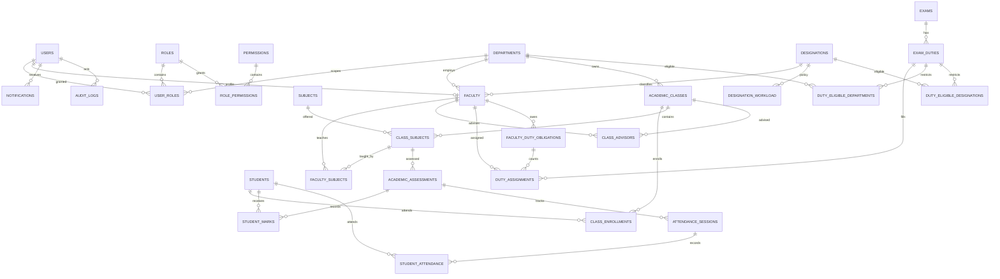

# Database Design

## Conventions

PostgreSQL is the system of record. Flyway migrations are forward-only and reviewed. Use UUID primary keys, `timestamptz` for instants, `date` for calendar dates, `numeric` for marks, and `varchar` plus `CHECK` constraints for controlled status values. Store timestamps in UTC; render in the university's configured timezone. Use `created_at`, `updated_at`, and `created_by` where applicable. Soft-deactivate reference/master records rather than deleting referenced history. Names and contact data are personal data; restrict access and retention.

All foreign keys should be indexed where PostgreSQL does not already create a suitable index. Add indexes for demonstrated query paths and verify with `EXPLAIN (ANALYZE, BUFFERS)` using representative data. `ON DELETE RESTRICT` is the default for academic and audit history. Assignment cancellation is a state transition, not a hard delete.

## ER diagram

## Table specification

Columns marked `PK`, `FK`, or `UQ` denote primary key, foreign key, or uniqueness. `UUID` identifiers are generated by the application or PostgreSQL. `JSONB` is reserved for bounded, versioned metadata or before/after audit snapshots, not core relationships.

### Identity and organization

| Table | Columns and rules |
|---|---|
| `users` | `id UUID PK`; `oidc_issuer varchar NOT NULL`; `oidc_subject varchar NOT NULL`; `employee_id varchar NULL`; `display_name varchar NOT NULL`; `email varchar NULL`; `active boolean NOT NULL DEFAULT true`; timestamps. `UQ(oidc_issuer, oidc_subject)`. Employee ID uniqueness is conditional on non-null and institution policy. Never store an application password. |
| `roles` | `id UUID PK`; `code varchar UQ NOT NULL` (`ADMIN`, `HOD`, `FACULTY`); `description`; `system_managed boolean`. The `CLASS_ADVISOR` responsibility is derived from an active advisor appointment, not a global role grant. |
| `permissions` | `id UUID PK`; `code varchar UQ NOT NULL`; `description`. Seed controlled permission definitions through migration. |
| `role_permissions` | `role_id UUID FK`; `permission_id UUID FK`; composite `PK(role_id, permission_id)`. Used for coarse capability mapping; resource-scope checks remain in application policy. |
| `departments` | `id UUID PK`; `code varchar UQ NOT NULL`; `name varchar NOT NULL`; `active boolean`; timestamps. |
| `user_roles` | `id UUID PK`; `user_id UUID FK`; `role_id UUID FK`; `department_id UUID NULL FK`; `granted_by UUID FK users`; `granted_at timestamptz`; `revoked_at timestamptz NULL`. Active uniqueness for `(user_id, role_id, department_id)`; `HOD` grants require a department scope, `ADMIN` may be global. |
| `designations` | `id UUID PK`; `code varchar UQ NOT NULL`; `name varchar UQ NOT NULL`; `active boolean`. Seed Professor, Associate Professor, Assistant Professor; policy values are not seeded as application constants. |
| `faculty` | `id UUID PK`; `user_id UUID UQ FK users`; `employee_id varchar UQ NOT NULL`; `department_id UUID FK`; `designation_id UUID FK`; `employment_status varchar CHECK`; `joined_on date NULL`; timestamps. |

### Academic organization and teaching

| Table | Columns and rules |
|---|---|
| `academic_years` | `id UUID PK`; `code varchar UQ NOT NULL`; `starts_on date`; `ends_on date`; `active boolean`; `CHECK(starts_on <= ends_on)`. |
| `academic_classes` | `id UUID PK`; `department_id UUID FK`; `academic_year_id UUID FK`; `code varchar NOT NULL` (for example `CSE-A`); `year_of_study smallint`; `section varchar`; `active boolean`; `UQ(department_id, academic_year_id, code)`. |
| `students` | `id UUID PK`; `student_number varchar UQ NOT NULL`; `display_name varchar NOT NULL`; `active boolean`; optional institutional identity reference if student login is later in scope. Keep unrelated personal data out of this table. |
| `class_enrollments` | `id UUID PK`; `student_id UUID FK`; `academic_class_id UUID FK`; `academic_year_id UUID FK`; `valid_from date`; `valid_to date NULL`; `status varchar CHECK`. Enforce at most one active enrollment per student and academic year with a partial unique index on `(student_id, academic_year_id) WHERE status='ACTIVE'`. Closed/historical enrollment rows may remain for transfers; changing an enrollment within the same year closes the previous row before activating the replacement. |
| `subjects` | `id UUID PK`; `department_id UUID FK`; `code varchar NOT NULL`; `name varchar NOT NULL`; `active boolean`; `UQ(department_id, code)`. |
| `class_subjects` | `id UUID PK`; `academic_class_id UUID FK`; `subject_id UUID FK`; `term varchar`; `active boolean`; `UQ(academic_class_id, subject_id, term)`. Represents a subject offering for a class. |
| `faculty_subjects` | `id UUID PK`; `faculty_id UUID FK`; `class_subject_id UUID FK`; `valid_from date`; `valid_to date NULL`; `active boolean`; unique active pair. Authorization to see student records is based on the active/appropriate teaching assignment. |
| `class_advisors` | `id UUID PK`; `faculty_id UUID FK`; `academic_class_id UUID FK`; `valid_from date`; `valid_to date NULL`; `assigned_by UUID FK users`; timestamps. Require `valid_to IS NULL OR valid_to > valid_from`. Prevent overlapping appointments for a class with a PostgreSQL GiST exclusion constraint on `(academic_class_id WITH =, daterange(valid_from, COALESCE(valid_to, 'infinity'::date), '[)') WITH &&)`. UUID equality in GiST requires PostgreSQL's `btree_gist` extension. The half-open range allows an advisor handoff on the same date the prior appointment ends. |

### Exams and workload

| Table | Columns and rules |
|---|---|
| `exams` | `id UUID PK`; `name varchar NOT NULL`; `academic_year_id UUID NULL FK`; `department_id UUID NULL FK` (null for institution-wide exam); `starts_on date NULL`; `ends_on date NULL`; `status varchar CHECK`; timestamps. |
| `exam_duties` | `id UUID PK`; `exam_id UUID FK`; `title varchar NOT NULL`; `starts_at timestamptz NOT NULL`; `ends_at timestamptz NOT NULL`; `venue varchar NOT NULL`; `capacity integer CHECK(capacity > 0)`; `eligibility_mode varchar NOT NULL CHECK IN ALL/RESTRICTED`; `selection_opens_at timestamptz`; `selection_closes_at timestamptz`; `status varchar CHECK IN OPEN/FULL/CLOSED/CANCELLED`; `created_by UUID FK users`; timestamps; `CHECK(starts_at < ends_at)` and window checks. Index `(status, selection_opens_at, selection_closes_at)` and `(starts_at, ends_at)`. In `ALL` mode, department/designation restriction rows are not required and must not be present. In `RESTRICTED` mode, at least one eligibility mapping row is required across the two mapping tables; each populated dimension is enforced, and an empty dimension is unrestricted. Validate cross-table mode/mapping consistency in the same transaction when changing a duty or its mappings. `FULL` is a derived/reconciled state; capacity count is authoritative. |
| `duty_eligible_departments` | `exam_duty_id UUID FK`; `department_id UUID FK`; composite `PK`. No rows means all departments unless the duty explicitly disables broad eligibility; define this consistently in the service/API. |
| `duty_eligible_designations` | `exam_duty_id UUID FK`; `designation_id UUID FK`; composite `PK`. No rows means all designations, subject to other eligibility constraints. |
| `designation_workload` | `id UUID PK`; `designation_id UUID FK`; `required_duties integer CHECK >= 0`; `effective_from date NOT NULL`; `effective_to date NULL`; `created_by UUID FK users`; `created_at`; `UQ(designation_id, effective_from)`; prevent overlapping effective ranges for a designation using an exclusion constraint or transactional service validation. ADMIN-managed and audited. Initial policy values are data, never source-code constants. |
| `faculty_duty_obligations` | `id UUID PK`; `faculty_id UUID FK`; `period_start date NOT NULL` (first day of month); `required_count integer CHECK >= 0`; `policy_id UUID FK designation_workload`; `status varchar CHECK IN OPEN/FINALIZED/EXEMPT`; `created_at`; `UQ(faculty_id, period_start)`. Snapshot the requirement when the period/selection cycle opens; changes require an explicit audited adjustment so policy edits do not silently rewrite prior obligations. |
| `duty_assignments` | `id UUID PK`; `exam_duty_id UUID FK`; `faculty_id UUID FK`; `obligation_id UUID NULL FK`; `assignment_type varchar CHECK IN SELF_SELECTED/AUTO_ASSIGNED/ADMIN_ASSIGNED`; `status varchar CHECK IN ACTIVE/CANCELLED`; `assigned_by UUID NULL FK users`; `assigned_at timestamptz`; `cancelled_by UUID NULL FK users`; `cancelled_at timestamptz NULL`; `cancellation_reason varchar NULL`; timestamps. Partial unique index on `(exam_duty_id, faculty_id) WHERE status='ACTIVE'`; index `(faculty_id, assigned_at)`, obligation, and duty. Obligation is nullable for approved extra/admin assignments. |

### Academic records, notifications, audit, and settings

| Table | Columns and rules |
|---|---|
| `academic_assessments` | `id UUID PK`; `class_subject_id UUID FK`; `name varchar`; `assessment_date date`; `max_marks numeric(7,2) CHECK > 0`; `term varchar`; `status varchar CHECK`; timestamps; index `(class_subject_id, assessment_date)`. |
| `grade_scale_entries` | `id UUID PK`; `scale_code varchar`; `grade_code varchar`; `minimum_percent numeric(5,2)`; `maximum_percent numeric(5,2)`; `active boolean`; uniqueness by scale and grade; validate non-overlap and full coverage when configured. Marks API returns computed grade according to active assessment/institution scale. |
| `student_marks` | `id UUID PK`; `assessment_id UUID FK`; `student_id UUID FK`; `marks_obtained numeric(7,2) CHECK >= 0`; `recorded_by UUID FK users`; `recorded_at timestamptz`; `updated_at`; `UQ(assessment_id, student_id)`. On insert/update, validate `marks_obtained <= assessment.max_marks` inside a transaction after loading and locking/otherwise protecting the assessment definition against concurrent changes. Grade is derived, not duplicated. |
| `attendance_sessions` | `id UUID PK`; `class_subject_id UUID FK`; `held_at timestamptz`; `session_label varchar NULL`; `status varchar CHECK`; `created_by UUID FK users`; index `(class_subject_id, held_at)`. |
| `student_attendance` | `id UUID PK`; `attendance_session_id UUID FK`; `student_id UUID FK`; `status varchar CHECK IN PRESENT/ABSENT/EXCUSED`; `recorded_by UUID FK users`; `recorded_at`; `UQ(attendance_session_id, student_id)`; index `(student_id, attendance_session_id)`. |
| `notifications` | `id UUID PK`; `user_id UUID FK`; `type varchar CHECK`; `title varchar`; `body varchar`; `resource_type varchar NULL`; `resource_id UUID NULL`; `created_at`; `read_at timestamptz NULL`; index `(user_id, created_at DESC)`; do not put sensitive marks in notification text. |
| `audit_logs` | `id UUID PK`; `actor_user_id UUID NULL FK users`; `action varchar`; `entity_type varchar`; `entity_id varchar`; `old_value jsonb NULL`; `new_value jsonb NULL`; `occurred_at timestamptz`; `source_ip inet NULL`; `request_id varchar NULL`; `outcome varchar`; index `(occurred_at DESC)`, `(entity_type, entity_id)`, `(actor_user_id, occurred_at DESC)`. Append-only to application role; redact secrets and unnecessary personal data. |
| `system_settings` | `key varchar PK`; `value jsonb NOT NULL`; `description varchar`; `updated_by UUID FK users`; `updated_at timestamptz`; only non-secret operational/policy settings. Secrets belong in a secret manager. |
| `job_runs` | `id UUID PK`; `job_type varchar`; `business_key varchar`; `status varchar CHECK IN CLAIMED/RUNNING/SUCCEEDED/PARTIAL/FAILED`; `started_at`; `finished_at NULL`; `attempt_count integer`; `last_error_code varchar NULL`; `UQ(job_type, business_key)` for idempotent business cycles. No sensitive stack traces or student data. |

## Integrity and concurrency rules

- Duty capacity is `COUNT(ACTIVE duty_assignments)` for a duty and must never exceed `exam_duties.capacity`. PostgreSQL has no simple cross-row `CHECK` for this invariant. Every assignment transaction locks the duty row with `SELECT ... FOR UPDATE`, rechecks status/window/eligibility and active count, then inserts. Any assignment writer, including admin and worker, uses the same service/locking protocol.
- Lock `faculty_duty_obligations` before the duty row for selection/assignment paths, in a consistent order. Recount active assignments for the obligation under lock before admitting a quota-consuming assignment. Retry recognized serialization/deadlock failures a bounded number of times with jitter.
- Unique partial indexes prevent duplicate active faculty-duty assignments. Conflict detection queries active assignments for overlapping `tstzrange(starts_at, ends_at, '[)')`; lock the faculty obligation row to serialize that faculty's concurrent selection requests. If stronger protection against cross-period extra assignments is needed, use a faculty assignment guard row and consistent lock order.
- Selection and automatic assignment use `@Transactional`; do not rely on a prior availability read from the UI. Admin override requires explicit actor, reason, and policy checks; an override never bypasses duty capacity, duplicate, or schedule-conflict invariants without a separately specified privileged exception.
- Keep duty status consistent with capacity in the same transaction, or derive availability from count and reconcile status. A stale `FULL`/`OPEN` label must not be able to permit over-allocation.

## Retention and access

Set retention periods for audit records, student academic data, notifications, and inactive identities with the institution's privacy/legal owners before launch. Add backup encryption, access monitoring, and tested point-in-time recovery. Provide no direct database credentials to end users or frontend workloads.