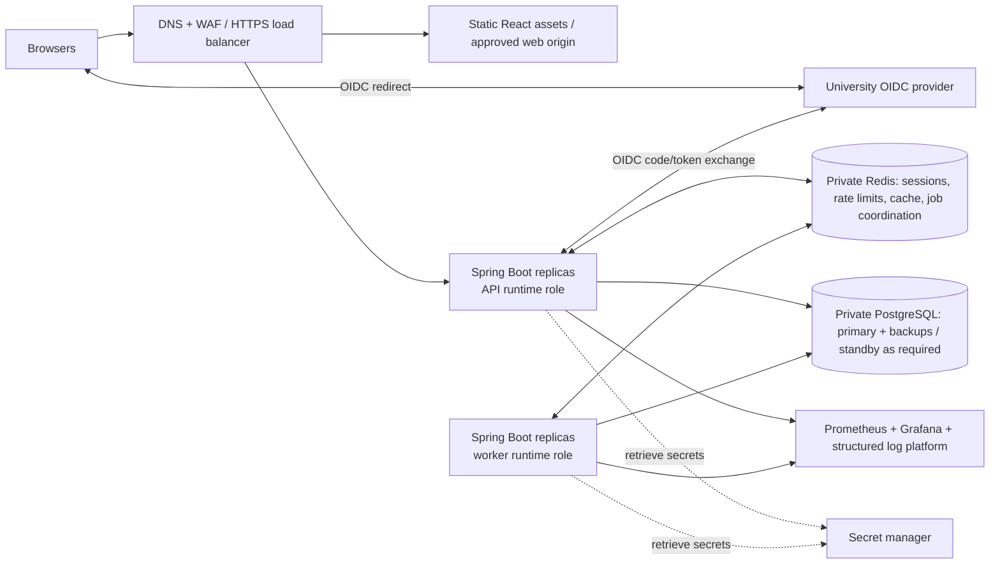

# Deployment Architecture

## Environments

1. **Local development:** Docker Compose for PostgreSQL, Redis, and a development Keycloak realm; frontend/backend may run in IDE processes or containers. Seed only synthetic data. Never reuse production credentials or academic records.
2. **CI/test:** ephemeral PostgreSQL/Redis and Keycloak-compatible test provider as needed; JUnit/Mockito plus Testcontainers integration tests. Build immutable frontend/backend artifacts and container images.
3. **Staging:** production-like topology and identity integration using non-production accounts/data. Exercise migrations, backups/restores, authorization, allocation races, load, and rollback/recovery procedures.
4. **Production:** institution-approved hosting/network, TLS ingress, multiple stateless API instances, independently scalable worker replicas from the same immutable Spring Boot application image/artifact, managed or highly available PostgreSQL, Redis, secret manager, monitoring, backup, and alerting. API and worker are runtime roles of the same modular-monolith application, selected through deployment configuration; they are not separate applications or microservices. Exact cloud/on-prem platform is a deployment decision, not assumed here.

## Logical production topology

API replicas and worker replicas may run the same immutable application image/artifact. Deployment configuration determines each process's runtime role. Worker replica count remains independently controllable from API replica count without creating a separate application or microservice.

## Container and network boundaries

- Public ingress accepts HTTPS only and routes to static web content and API. Apply WAF/rate controls according to institutional standards. Redirect HTTP to HTTPS; enable HSTS when appropriate.
- API and worker are private workloads with outbound access limited to required IdP, database, Redis, telemetry, and approved services. PostgreSQL and Redis have no public listeners.
- Use separate service identities and network policies. Normal API and worker runtime identities have only required DML rights and do not perform schema migrations or DDL. Flyway migrations run through a controlled deployment/migration job using the separate migration identity. Application startup must not let each production replica independently run uncontrolled migrations.
- Run containers as non-root, use minimal pinned base images, read-only filesystem where practical, health/readiness probes, resource requests/limits, and graceful shutdown. Do not bake environment secrets into images.
- **Liveness** indicates that the process is alive. **Readiness** indicates that an instance can safely receive traffic and that dependencies/configuration required by the application's readiness policy are available. Readiness prevents traffic from reaching an instance that cannot safely serve requests. Public health endpoints expose no sensitive dependency details.
- During graceful shutdown, API and worker instances stop receiving new work and allow in-flight requests/jobs to complete within a bounded shutdown period. Workers safely finish or release owned job work according to the existing database-backed job model; idempotent job/assignment behavior prevents duplicate allocation on restart. Do not add distributed locking beyond the existing database-backed coordination model.
- Production frontend should be same-site with API where practical for session cookie and CSRF simplicity. If origins differ, allow only exact origins and credential behavior must be reviewed.

## Scaling and resilience

- Scale API replicas horizontally behind the load balancer. Externalize web sessions to Redis so replicas have no local session dependency. Use connection pooling with total maximum connections sized against PostgreSQL limits across all replicas and workers.
- Scale worker replicas independently. Use idempotent job claims and database-backed state; tune worker concurrency to protect PostgreSQL. Duty capacity correctness does not depend on Redis locks.
- Redis is a session/cache/rate-limit and permitted job-coordination dependency, never authoritative for users or local authorization relationships, academic data, exam duties, assignments, workload obligations, allocation job state, or audit records. PostgreSQL is the authoritative source of truth for all of these records. Redis must never become their authoritative store.
- During a Redis outage, do not silently fall back to local in-process sessions, bypass authentication/authorization, or create parallel session state across API replicas. Authenticated session-dependent requests fail safely according to the application's documented availability/error behavior when the required session store is unavailable.
- Production PostgreSQL backups must be encrypted, access-controlled, monitored, restored through tested procedures, and retained according to institutional policy. A successful backup job alone does not make a backup operationally valid; restore verification is required. Add read replicas only after measurements; do not send consistency-sensitive duty operations to replicas.
- Define SLOs, RPO/RTO, maintenance windows, and regional/zone failure requirements with the university. These are not specified, so no numerical guarantees are assumed.

## Configuration and secrets

Environment-specific non-secret settings use deployment configuration. Secrets (OIDC client secret, database credentials, Redis credentials, signing/encryption keys) come from a secret manager or protected deployment secret injection and are rotated. Commit `.env.example` with placeholders only. Keep a distinct OIDC client, database, Redis namespace, and encryption material per environment.

## CI/CD and migrations

GitHub Actions should run format/static checks, frontend and backend tests, Testcontainers integration tests, dependency/secret/container scans, image build, and migration validation. Protect production deployments with approval and least-privilege environment credentials. Promote the same immutable image through environments.

Use expand-and-contract Flyway migrations for rolling deployment compatibility. Normal API/worker startup does not perform schema migrations, and production replicas must not independently run uncontrolled migrations. Run migrations through the controlled deployment/migration job using the migration identity.

Safe rolling-deployment sequence:

1. Validate backup/recovery readiness when required.
2. Apply the backward-compatible database migration through the controlled migration job.
3. Deploy the compatible immutable application image.
4. Verify health/readiness and critical application flows.
5. Run required post-deployment checks.
6. Only after the compatibility window has ended, perform any later cleanup/constraining migration steps that are required.

This preserves expand-and-contract: additive nullable columns/tables first, compatible application deployment and any needed backfill next, then cleanup or tighter constraints in a later release after compatibility is no longer needed. Not every deployment requires a separate destructive migration. Do not run destructive schema changes automatically without a reviewed recovery plan. Back up before high-risk migrations and test migration/restore against staging-like data.

## Observability and operations

- Prometheus metrics: request rates/latency/errors, JVM/GC, DB pool, Redis, allocation run status/duration, quota gaps, capacity conflicts, and job retries. Avoid student/faculty identifiers as labels.
- Grafana dashboards and alerts cover service health, IdP failures, database saturation, worker lag, allocation failures, capacity invariant violations, TLS/certificate expiry, disk, backups, and restore verification.
- Emit structured JSON logs with timestamp, severity, service/version, request/correlation ID, module, operation, and outcome. Request/correlation IDs may be used for tracing but must not contain personal identifiers. Logs must not contain passwords, OIDC tokens or authorization headers, session cookies, database credentials, secrets, unnecessary student marks, or unnecessary personal/academic payloads. Loki/ELK can be added later; local structured console logs are sufficient initially.
- Document deployment, rollback, identity-provider configuration, key/secret rotation, backup restore, incident response, and operational ownership before public launch.

## Capacity validation

10,000 registered users is not equivalent to 10,000 concurrent users and is not a throughput target by itself. Agree expected simultaneous sessions, selection peak request rate, report workload, and response-time objectives without assuming numerical throughput or latency targets here. Use k6 or JMeter to measure normal dashboard traffic, synchronized duty-selection contention, the final-slot race, concurrent selections by many faculty, report/query workload, automatic allocation, and recovery after dependency saturation/failure. Success criteria include no duty over-allocation, no duplicate active assignment, no quota race, no persistent deadlock/serialization storm, acceptable error/latency behavior against agreed objectives, and no uncontrolled PostgreSQL connection exhaustion.